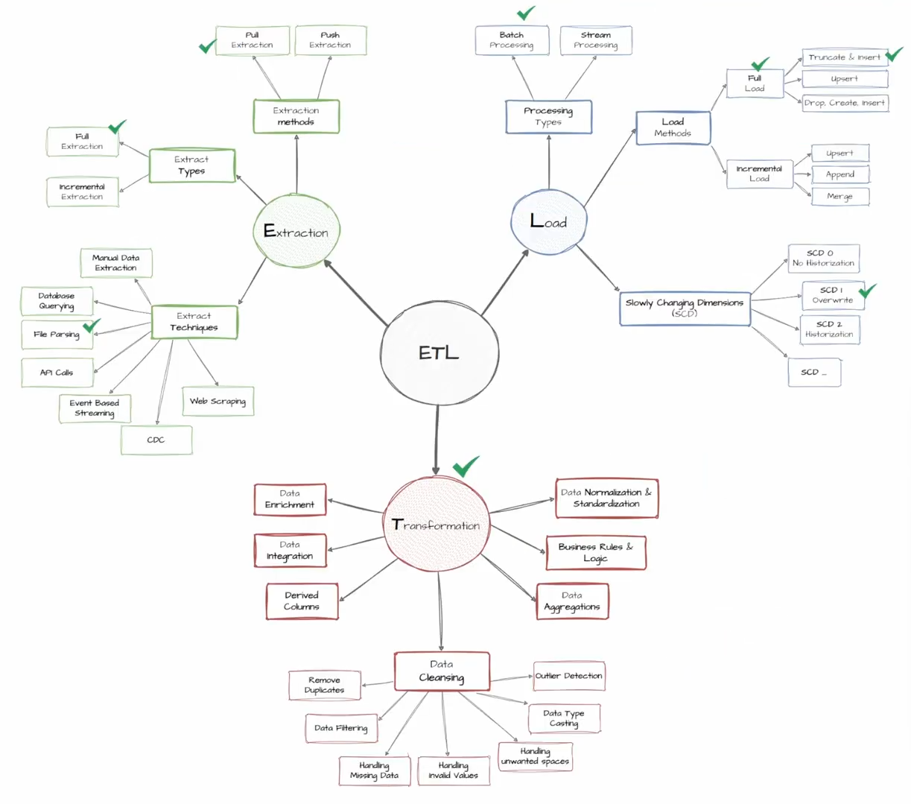

# 🚀 SQL Server Data Warehouse & Advanced Analytics

**An End-to-End Data Engineering Project | SQL Server 2022 | T-SQL | ETL | Medallion Architecture | Star Schema**

An end-to-end Data Engineering project demonstrating the design and implementation of a SQL Server data warehouse, integrating raw sales data from CRM and ERP systems into a structured, analytics-ready solution.

Built using **Microsoft SQL Server 2022**, the project follows the Medallion Architecture (Bronze, Silver, and Gold) to organize data ingestion, transformation, and modeling. It also incorporates data quality validation, exploratory analysis, and advanced SQL analytics to extract meaningful business insights.

The project covers the complete data engineering workflow, from raw data ingestion to business-oriented analytical reporting.

---

## 📑 Table of Contents

- [Project Overview](#-project-overview)
- [Architecture](#️-architecture)
- [Data Sources](#-data-sources)
- [Data Warehouse Implementation](#️-data-warehouse-implementation)
- [Data Quality & Validation](#-data-quality--validation)
- [Analytics & Reporting](#-analytics--reporting)
- [Repository Structure](#-repository-structure)
- [Technologies & Concepts](#️-technologies--concepts)
- [Getting Started](#-getting-started)
- [Key Skills Demonstrated](#-key-skills-demonstrated)
- [About Me](#-about-me)
- [License](#-license)

---

## 🎯 Project Overview

The primary objective is to build a centralized data warehouse that integrates sales-related data from different operational systems and prepares it for analytical workloads.

The project is organized into three main areas:

### 1. Data Engineering

- Integrate CRM and ERP datasets from CSV files.
- Design a structured data warehouse using the Medallion Architecture.
- Develop ETL processes using SQL Server and T-SQL stored procedures.
- Clean, standardize, and transform raw data.
- Build a business-oriented analytical model using a Star Schema.

### 2. Data Quality & Validation

- Identify missing and inconsistent values.
- Detect duplicate records.
- Validate relationships between fact and dimension views.
- Perform data quality checks across the Silver and Gold layers.

### 3. Data Analytics

- Explore database structures and business dimensions.
- Analyze sales measures and business performance.
- Identify sales trends and cumulative performance.
- Evaluate product and customer contributions.
- Segment customers and products.
- Generate analytical reports using advanced SQL techniques.

---

## 🏗️ Architecture

The data warehouse follows the **Medallion Architecture**, organizing the ETL pipeline into three logical layers.

### Data Architecture


### ETL Process



### Data Flow


### Data Integration


### Medallion Architecture

| Layer | Description | Main Operations |
|:---|:---|:---|
| 🥉 **Bronze** | Raw data layer | Ingest CRM and ERP source data with minimal transformation. |
| 🥈 **Silver** | Cleansed data layer | Clean, standardize, validate, and transform raw records. |
| 🥇 **Gold** | Business-ready layer | Expose analytical data through views organized around a Star Schema. |

**Overall workflow:**

```text
       CRM & ERP Source Systems
                 |
                 v
          CSV Source Files
                 |
                 v
        +-------------------+
        |   BRONZE LAYER    |
        |   Raw Data        |
        +-------------------+
                 |
                 v
        +-------------------+
        |   SILVER LAYER    |
        | Clean & Transform |
        +-------------------+
                 |
                 v
        +-------------------+
        |    GOLD LAYER     |
        |  Analytical Views |
        |    Star Schema    |
        +-------------------+
                 |
                 v
        +-------------------+
        |  SQL Analytics    |
        | Reports & Insights|
        +-------------------+
```

---

## 📂 Data Sources

The project integrates data from two source systems: **CRM** and **ERP**.

### CRM Datasets

| File | Description |
|:---|:---|
| `cust_info.csv` | Customer information. |
| `prd_info.csv` | Product information. |
| `sales_details.csv` | Sales transaction details. |

### ERP Datasets

| File | Description |
|:---|:---|
| `CUST_AZ12.csv` | Additional customer information. |
| `LOC_A101.csv` | Customer location information. |
| `PX_CAT_G1V2.csv` | Product category information. |

These datasets are integrated to provide a unified view of customers, products, and sales transactions.

---

## ⚙️ Data Warehouse Implementation

### 🥉 Bronze Layer — Raw Data Ingestion

The Bronze layer stores source data from CRM and ERP systems in its raw form.

**Implementation:**

- Create Bronze tables using SQL DDL scripts.
- Load CSV files using SQL Server `BULK INSERT`.
- Implement stored procedures to execute data ingestion.
- Handle execution errors using `TRY...CATCH`.
- Use transactions to manage loading operations.
- Capture execution time to monitor loading performance.

**Main scripts:**

- `scripts/bronze/ddl_bronze.sql`
- `scripts/bronze/proc_load_bronze.sql`

### 🥈 Silver Layer — Data Cleaning & Transformation

The Silver layer transforms raw data into clean, consistent, and standardized datasets.

**Implementation:**

- Create Silver tables using SQL DDL scripts.
- Clean and standardize source data.
- Handle duplicates and inconsistent records.
- Resolve data quality issues.
- Apply business transformation rules.
- Standardize date formats and categorical values.
- Implement stored procedures to execute transformations.

**Main scripts:**

- `scripts/silver/ddl_silver.sql`
- `scripts/silver/proc_load_silver.sql`

### 🥇 Gold Layer — Analytical Views & Dimensional Modeling

The Gold layer exposes business-ready data through SQL views designed for analytical queries and reporting.

The data is organized according to a **Star Schema**, consisting of fact and dimension views.

### Data Model


**Dimension Views**

| View | Description |
|:---|:---|
| `gold.dim_customers` | Provides customer attributes and descriptive information. |
| `gold.dim_products` | Provides product attributes and category information. |

**Fact View**

| View | Description |
|:---|:---|
| `gold.fact_sales` | Exposes sales transactions, dimensional keys, and numerical measures. |

The views provide a business-friendly structure that simplifies analytical queries and separates reporting logic from the underlying transformation layer.

**Main script:**

- `scripts/gold/ddl_gold.sql`

### Data Catalog

The project includes a data catalog documenting the Gold Layer views, columns, and their descriptions.

📖 [View the Gold Layer Data Catalog](docs/data_catalog.md)

---

## 🧪 Data Quality & Validation

Data quality is an important part of the pipeline. Dedicated SQL scripts validate transformed datasets and help ensure the reliability of analytical results.

**Silver Layer Checks**

- Validate data consistency.
- Identify duplicate records.
- Check for invalid or unexpected values.
- Verify transformation results.

**Gold Layer Checks**

- Validate dimension and fact view records.
- Check for duplicate dimension records.
- Verify fact-to-dimension relationships.
- Identify missing or invalid values.

**Validation scripts:**

- `test/quality_checks_silver.sql`
- `test/quality_checks_gold.sql`

---

## 📊 Analytics & Reporting

After building the data warehouse, SQL queries are used to explore the data and generate business insights.

The analytics component is divided into two sections.

### 1. Exploratory Data Analysis

The exploratory analytics scripts provide an initial understanding of the database structure, dimensions, and business performance.

| Script | Description |
|:---|:---|
| `01_database_exploration.sql` | Explore database objects, tables, and available data. |
| `02_dimensions_exploration.sql` | Examine customer and product dimensions. |
| `03_measures_and_performance.sql` | Analyze key measures and sales performance. |

**Location:** `scripts/analytics/`

### 2. Advanced SQL Analytics

This section applies advanced SQL techniques to investigate business performance and customer and product behavior.

| Script | Analysis | Description |
|:---|:---|:---|
| `01_change_over_time.sql` | Change Over Time | Analyze sales trends across different periods. |
| `02_cumulative_analysis.sql` | Cumulative Analysis | Calculate running totals and cumulative metrics. |
| `03_performance_analysis.sql` | Performance Analysis | Evaluate product performance and compare results over time. |
| `04_part_to_whole_analysis.sql` | Part-to-Whole | Measure the contribution of products and categories to total sales. |
| `05_data_segmentation.sql` | Data Segmentation | Segment customers and products based on business rules. |
| `06_customer_report.sql` | Customer Report | Generate customer-level metrics and behavioral insights. |
| `07_product_report.sql` | Product Report | Generate product-level metrics and performance insights. |

**Location:** `scripts/advanced analytics/`

### Business Metrics & Insights

**Customer Analytics**
- Total sales per customer.
- Customer lifespan.
- Average order value.
- Average monthly spending.
- Purchasing activity.
- Customer segmentation (VIP, Regular, and New).

**Product Analytics**
- Total sales and quantity sold.
- Average selling price.
- Product performance.
- Revenue contribution.
- Product segmentation based on sales performance.

**Sales Analytics**
- Monthly and yearly sales trends.
- Running totals.
- Cumulative sales performance.
- Product and category contribution to overall sales.

---

## 📁 Repository Structure

```text
Sql_Data_Warehouse_Project/
│
├── datasets/
│   ├── crm/
│   │   ├── cust_info.csv
│   │   ├── prd_info.csv
│   │   └── sales_details.csv
│   │
│   └── erp/
│       ├── CUST_AZ12.csv
│       ├── LOC_A101.csv
│       └── PX_CAT_G1V2.csv
│
├── docs/
│   ├── DATA MODEL.png
│   ├── Data Architecture.png
│   ├── Data Integration.png
│   ├── ETL.png
│   ├── data flow.png
│   └── data_catalog.md
│
├── scripts/
│   ├── advanced analytics/
│   │   ├── 01_change_over_time.sql
│   │   ├── 02_cumulative_analysis.sql
│   │   ├── 03_performance_analysis.sql
│   │   ├── 04_part_to_whole_analysis.sql
│   │   ├── 05_data_segmentation.sql
│   │   ├── 06_customer_report.sql
│   │   └── 07_product_report.sql
│   │
│   ├── analytics/
│   │   ├── 01_database_exploration.sql
│   │   ├── 02_dimensions_exploration.sql
│   │   └── 03_measures_and_performance.sql
│   │
│   ├── bronze/
│   │   ├── ddl_bronze.sql
│   │   └── proc_load_bronze.sql
│   │
│   ├── silver/
│   │   ├── ddl_silver.sql
│   │   └── proc_load_silver.sql
│   │
│   ├── gold/
│   │   └── ddl_gold.sql
│   │
│   └── init_database.sql
│
├── test/
│   ├── quality_checks_gold.sql
│   └── quality_checks_silver.sql
│
└── README.md
```

---

## 🛠️ Technologies & Concepts

### Technologies

| Technology | Usage |
|:---|:---|
| Microsoft SQL Server 2022 | Database management and data warehousing. |
| T-SQL | Data ingestion, transformation, and analytical queries. |
| SQL Server Management Studio (SSMS) | Database development and query execution. |
| CSV | Source data format. |
| Git & GitHub | Version control and project documentation. |

### Technical Concepts

- Data Warehousing
- ETL Pipeline Development
- Medallion Architecture
- Dimensional Modeling
- Star Schema
- SQL Views
- Data Cleaning & Transformation
- Data Quality Validation
- SQL Stored Procedures
- CTEs and Window Functions
- Aggregations and Subqueries
- Advanced SQL Analytics
- Business Intelligence Concepts

---

## 🚀 Getting Started

Follow these steps to explore and execute the project locally.

### Prerequisites

- Microsoft SQL Server 2022.
- SQL Server Management Studio (SSMS).
- Git.
- Access to the project's CRM and ERP CSV datasets.

### 1. Clone the Repository

```bash
git clone https://github.com/aliyoucef599/Sql_Data_Warehouse_Project.git
```

### 2. Open the Project

Open SQL Server Management Studio and connect to your SQL Server instance.

### 3. Initialize the Database

Execute:

```text
scripts/init_database.sql
```

This script initializes the database and its required schemas.

### 4. Build the Bronze Layer

Execute:

```text
scripts/bronze/ddl_bronze.sql
scripts/bronze/proc_load_bronze.sql
```

Then manually execute the Bronze loading stored procedure to import the CRM and ERP CSV datasets.

### 5. Build the Silver Layer

Execute:

```text
scripts/silver/ddl_silver.sql
scripts/silver/proc_load_silver.sql
```

Then manually execute the Silver transformation stored procedure to clean and standardize the imported data.

### 6. Build the Gold Layer

Execute:

```text
scripts/gold/ddl_gold.sql
```

This script creates the analytical views used by the reporting and analytics queries.

### 7. Validate Data Quality

Run the validation scripts:

```text
test/quality_checks_silver.sql
test/quality_checks_gold.sql
```

### 8. Explore the Analytics

Execute the scripts inside:

```text
scripts/analytics/
scripts/advanced analytics/
```

**Important:** The CSV loading procedure requires valid file paths accessible to the SQL Server service. Update the paths in the loading scripts to match your local environment before execution.

The ETL pipeline is executed manually through stored procedure calls. Run the loading and transformation steps in the order described above.

---

## 💡 Key Skills Demonstrated

This project demonstrates practical experience in:

- Designing an end-to-end SQL Server Data Warehouse.
- Building ETL pipelines using T-SQL and stored procedures.
- Implementing a Medallion Architecture.
- Integrating data from multiple operational systems.
- Cleaning and transforming real-world datasets.
- Designing Star Schema dimensional models.
- Creating analytical views for business reporting.
- Implementing data quality and validation checks.
- Writing advanced SQL queries using CTEs, window functions, and aggregations.
- Developing customer and product analytical reports.
- Documenting and organizing a complete data engineering project.

---

## 👨‍💻 About Me

Hi! I'm **Alibelhadj Youcef**, a Computer Science graduate passionate about **Data Engineering, Data Analytics **.

I enjoy building data pipelines, designing data warehouses, exploring analytical techniques, and transforming raw data into meaningful insights.

### 🎯 My Goal

To continuously develop my technical skills, explore modern data technologies, and build scalable, reliable, and data-driven solutions.

---

## 📜 License

This project is licensed under the **MIT License**. See the [LICENSE](LICENSE) file for details.

---

⭐ **Thank you for visiting this repository!**

If you find this project interesting, feel free to explore the SQL scripts, review the architecture, and leave a star.
